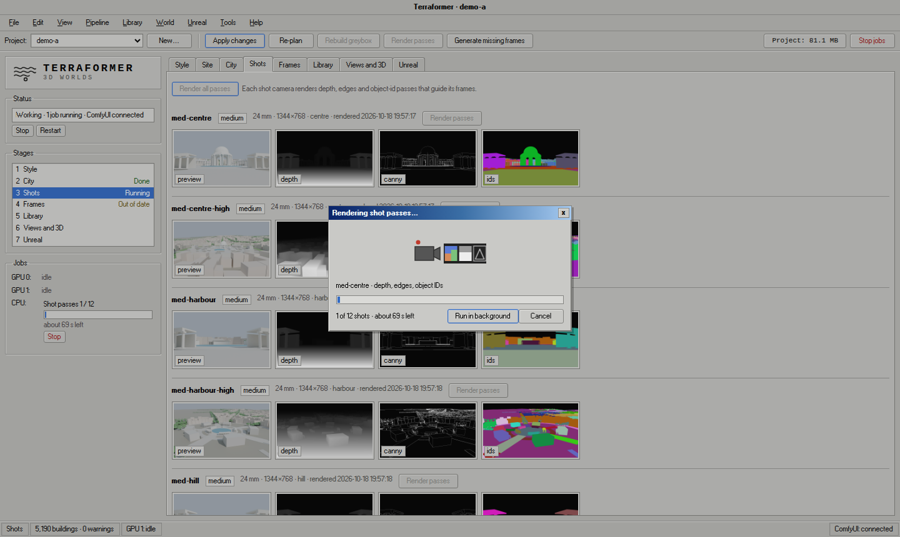

# Terraformer

Terraformer, a 3D environment pipeline: a local-first pipeline from a world layout to an Unreal Engine 5.8 scene, built around
ComfyUI. You lay out a place (roads, districts, landmarks, terrain); the pipeline builds a
Blender greybox, renders control passes for each camera shot, paints concept frames from them
with FLUX.1-dev, plans which assets the frames call for, builds those assets, imports them into
Unreal and lights a scene that matches the approved frame. Everything runs on your own
machine with open-weights models. No partner or API nodes, no hosted services.

Entry for the Comfy "Open Source Higgsfield" challenge, category **Open Weights Only**.

The repo is [`hawkins-m/terraformer-3d`](https://github.com/hawkins-m/terraformer-3d) (renamed from `asset-pipeline` on 2026-10-18;
the old URL redirects). The command line is `ap`, the Python package is `asset_pipeline`, and
the UI (`ap ui`) is called Terraformer.

## Design



Terraformer's interface is deliberately styled after Windows XP/Me-era desktop software: menu
bar, toolbar, group boxes, tabbed panels, status bar and Tahoma / MS Sans Serif-style type. Its
muted grey palette avoids near-white glare during long sessions. Each pipeline stage has its own
small animated job icon (frame generation, greybox building, 3D conversion, Unreal export and
more), so long GPU jobs stay readable at a glance. The intent is a calm, dense, tool-like
workspace for artists rather than a web-app look.

## How it works

One line per stage, in order. **Artist:** marks a decision point; everything else runs unattended.
Each stage is also a button or menu item in the app, so after installing nobody needs the
terminal: [RUNBOOK.md](RUNBOOK.md) describes the clicks.

1. **Brief and site layout.** `ap new`, `ap site init` (or `--city`), `ap style text`; no GPU needed. **Artist:** edits the layout and the brief.
2. **Greybox.** `ap site build` makes terrain and a greybox in headless Blender (CPU).
3. **Shot passes.** `ap shots render` renders exact depth, edge, object-id and normal passes per camera shot (Blender Cycles, CPU).
4. **Frames.** `ap frames generate SHOT -n 4`: FLUX.1-dev with ControlNet Union Pro 2.0 (depth) and Redux through ComfyUI. **Artist:** picks and locks frames (`ap frames lock`, `ap frames role`).
5. **Reference sheets.** `ap library plan`, `ap library check` (SAM 3.1), then `ap library sheets`: FLUX.1-dev sheets of each asset. **Artist:** decides each entry's source and picks the sheet view.
6. **VLM brief.** `ap library brief PROJECT ASSET SHEET front`: Qwen3-VL (32B via llama.cpp) and image analysis read proportions, palette and materials off the sheet. **Artist:** edits the brief form fields.
7. **Procedural / TRELLIS build.** `ap library build` (procedural Blender, ambientCG materials) for architecture; `ap library trellis` (TRELLIS.2) for irregular assets and props; `ap library instances` for per-building builds.
8. **Review gate.** Library › Asset review, `ap library review apply`. **Artist:** approves, or marks needs changes with a note.
9. **Vegetation zones.** `ap site vegetation`: zones and street-tree slots are tagged on every build and exported; the plants come from a PCG graph in Unreal.
10. **Unreal placement.** `ap export`, then `ap ue import` (Unreal Engine 5.8, headless); `ap ue backup` snapshots the project.
11. **Look match.** `ap ue look PROJECT SHOT`: tints, exposure and the far ridge are read from the approved frame (OneFormer, Depth Anything V2) and rendered in Unreal. **Artist:** chooses and tunes the look preset.

## What it does

1. **Layout to greybox.** A layout (`site/layout.json`) becomes a Blender greybox, built
   headless on the CPU (about 4 s for the starter layout).
2. **Shot passes.** For each camera shot Blender renders depth, edges, object ids and normals
   (exact data passes, about 3.5 s per shot).
3. **Concept frames (ComfyUI).** FLUX.1-dev with ControlNet Union Pro 2.0 (depth) and a Flux
   Redux style anchor paints frames that keep the greybox's layout and scale. Every
   frame-generation step goes through ComfyUI, with the workflows in `workflows/`.
4. **Library planning.** The id pass tells which greybox object is where in an approved frame;
   SAM 3.1 (ComfyUI) checks the crops.
5. **Assets.** Architecture is built procedurally in Blender from a brief read off reference
   sheets (Qwen3-VL reads the material of each storey band; textures are ambientCG CC0 scans).
   Irregular assets can go through TRELLIS.2 instead (optional).
6. **Export and Unreal.** GLB export from Blender, then a headless Unreal Engine 5.8 import of
   the library and instances.
7. **Look scenes.** An Unreal scene is matched to the approved frame: tints, exposure and the
   far ridge are read from the frame with OneFormer and Depth Anything V2.

## Status

Verified on one machine: Ubuntu 26.04, 2x AMD Radeon AI PRO R9700 (32 GB, gfx1201), ROCm
7.2.4, ComfyUI 0.24.0, Blender 5.2.2, Unreal Engine 5.8.3.

- Full test suite: 635 tests (633 offline; 2 more need a live ComfyUI), all passing.
- Clean install (2026-10-23): the Install steps above as written, from a fresh clone with an empty
  `HOME` and no config: `ap setup`, the app's first-run Setup screen, `ap doctor`, a new project
  and its greybox. The multi-GB model downloads (steps 4-6) and GPU jobs were left out.
- The two ComfyUI backends (below) give identical SAM 3.1 results (`pytest -m comfy`), and
  the SDK backend's cancel and error handling were checked against a live ComfyUI.
- Starter path (`scripts/demo.sh starter`) through the SDK backend, on a fresh `AP_ROOT`:
  greybox and two shots' passes in about 16 s (CPU), two concept frames in 67 s.
- Area path (`scripts/demo.sh area`) on one shot of a larger private test city (about 2.3k
  buildings, 381 exported assets, 29k instances): two frames about 1 min each through the SDK
  backend, 11 procedural builds in about 1 min, about 620 per-building instances near the shot in
  25 min (CPU), export about 3 min, Unreal import about 2 min, look scene 5-11 min (three
  exposure passes, GPU). 138 builds placed in the rendered scene.

**NVIDIA / CUDA is untested.** The code has a CUDA path (see below), but only ROCm has been run.
Expect to debug it.

## Requirements

- Linux (verified on Ubuntu 26.04). Windows and macOS are not supported.
- Python 3.12 (`python3.12`; the default `python3` may be newer, and every venv here uses 3.12).
- ComfyUI, 0.24 or newer (the tested version), with the model files below. The workflows use
  only core nodes (SAM 3.1 included); `ap doctor` shows which model files are missing.
- Blender 4.2 or newer (verified with 5.2.2; the snap works). `ap setup` finds it on `PATH`, the
  snap, `/opt` or your home folder, or asks for its path.
- Unreal Engine 5.8 (free with an Epic account) for the last steps only: import and look
  scenes. The demo's starter path does not need it.
- GPU memory:
  - Concept frames (Flux fp8, ControlNet, Redux): about 24 GB. The author uses one 32 GB card.
  - Vision LLM: the default Qwen3-VL-32B Q5_K_M takes about 27 GB on its own GPU. With 24 GB or
    less, use the 8B (Q8_0 GGUF, or bf16 at about 18 GB): `ap config set local.model 8b`.
  - Two GPUs are recommended: ComfyUI on one, the VLM, TRELLIS and Unreal renders on the other.
    One 32 GB GPU works if the jobs run one after another (the VLM unloads after 600 s idle).
    The VLM and TRELLIS never share a GPU; this is handled automatically. Unreal renders check
    VRAM first.
- Disk: several hundred GB is comfortable (Flux, VLM weights, TRELLIS, Unreal projects). All
  of it goes under one storage folder (default `~/.local/share/terraformer`; `ap setup` asks).

## Hardware profiles

`ap setup` detects the GPU vendor, count and VRAM (`rocm-smi` / `nvidia-smi`) and preselects a
profile; you can override it (`ap config set hardware.profile ...`). The profile sets the PyTorch
build the model environments install, which GPU each job lane uses, and the scheduling.

| Profile | PyTorch | GPU lanes | Status |
|---|---|---|---|
| Ubuntu + ROCm, 2 GPUs (`rocm-2gpu`) | ROCm 7.2 | TRELLIS and the vision model on GPU 0, ComfyUI on GPU 1 | the tested setup |
| Ubuntu + ROCm, 1 GPU (`rocm-1gpu`) | ROCm 7.2 | everything on GPU 0, one job at a time | scheduling tested by simulation only |
| Ubuntu + NVIDIA (`nvidia`) | CUDA 12.8 | as above, by GPU count | **untested**: the CUDA paths have never run |

- With one GPU, ComfyUI, TRELLIS and the vision model share one slot and run in submit order;
  before TRELLIS or the vision model starts, ComfyUI is asked to unload its models, and before a
  ComfyUI job the vision model is unloaded. Jobs wait (queued, with the reason shown) until the
  GPU has the memory the model manifest says they need.
- Each feature has a VRAM floor from the manifest (ComfyUI image models ~24 GB, the 32B vision
  model ~28 GB, the 8B ~19 GB, TRELLIS.2 ~16 GB). A feature the card can't run is switched off
  in the app with the reason; below ~28 GB Setup offers the 8B vision model.
- Memory held by programs the app didn't start is never touched: the app names them with their
  PID. TRELLIS retries once after an out-of-memory error, having freed what it can, then says
  in plain words what it needed and what holds the GPU.
- PyTorch's `expandable_segments` allocator is set for GPU jobs only on the NVIDIA profile; on
  ROCm (gfx1201) it gave silent NaNs, so the ROCm profiles keep the default allocator.

Install steps that differ per profile (the rest of Install is the same):

- **ROCm, 2 GPUs**: as written below.
- **ROCm, 1 GPU**: in step 7 pick `Ubuntu + ROCm, 1 GPU` (both GPU roles on GPU 0). With less
  than ~28 GB on the card, take the 8B vision model before downloading:
  `ap config set local.model 8b`, then `ap models download --required` (43.7 GB).
- **NVIDIA (untested)**: pick `Ubuntu + NVIDIA (untested)` in `ap setup` first, so the model
  environments install CUDA wheels (or `export AP_TORCH=cu128` for the install scripts); skip
  `scripts/setup_rocm_toolchain.sh`; TRELLIS.2 needs the CUDA toolkit for its extensions. Expect
  to debug: see CUDA (untested) below.

## Install

Nothing in the repo names a machine. Your settings live in one user config outside it,
`~/.config/terraformer/config.toml` (API keys in `secrets.toml` beside it, mode 0600), written by
`ap setup` (step 7); environment variables win over it. Everything big (venvs, weights, projects,
outputs) goes under one storage folder, by default `~/.local/share/terraformer`. To put it on a
big drive, set it before the downloads below (they go into it):

```bash
ap config set paths.ap_root /path/to/storage/terraformer   # after step 1; or export AP_ROOT=... for one shell
```

1. **The pipeline.**
   ```bash
   git clone https://github.com/hawkins-m/terraformer-3d.git && cd terraformer-3d
   python3.12 -m venv .venv && source .venv/bin/activate
   pip install -e '.[dev]'
   mkdir -p ~/.local/bin && ln -sf "$PWD/scripts/ap" ~/.local/bin/ap   # `ap` in any shell, venv or not
   ```
   The repo is called `terraformer-3d`, but the command is still `ap` and the Python package is
   still `asset_pipeline` (pip lists it as `asset-pipeline`): scripts, imports and config keep
   their names. A checkout cloned under the old name keeps working; point it at the new URL with
   `git remote set-url origin https://github.com/hawkins-m/terraformer-3d.git`.
   The `[paid]` extra (Gemini and Claude SDKs) is not needed and the paid backends refuse to run
   unless `AP_ALLOW_PAID_APIS=1` is set for a run.

2. **ComfyUI and its models.** Install ComfyUI yourself (its own venv; this repo only talks to
   it over HTTP and never modifies it), tell the pipeline where its models folder is, then fetch
   the five model files the workflows load (24.3 GB):
   ```bash
   ap config set comfyui.models_dir ~/ComfyUI/models    # or let `ap setup` find it from a running ComfyUI
   ap models download --feature comfy --required --dry-run   # the plan and the disk check
   ap models download --feature comfy --required
   ```
   FLUX.1 Redux dev is gated: the download stops and says what to do (accept its license on the
   model page, then a Hugging Face read token via `hf auth login` or `ap setup`). Files already
   there are skipped, a partial file resumes, and each file's checksum is verified.
   (`scripts/fetch_models.sh` does the same.)

   So the app can start ComfyUI for you, `ap setup` (step 7) asks for its launch command and
   folder (the default runs `python main.py` in `~/ComfyUI`; give your venv's python or your run
   script, `{port}` is filled in) and pins it to the ComfyUI GPU. By hand:
   ```bash
   ap config set comfyui.service.launch "~/ComfyUI/venv/bin/python main.py --listen 127.0.0.1 --port {port}"
   ap config set comfyui.service.cwd ~/ComfyUI
   ```
   Then `ap comfy start` (also `stop`, `restart`, `status`), or **Start ComfyUI** in the app's
   Status box. The port comes from `[comfyui] url` (default `http://127.0.0.1:8188`); the log
   goes to `<storage>/logs/comfyui.log`. It only launches and stops ComfyUI; it never changes
   its install. A job that needs ComfyUI while it's down offers **Start ComfyUI and run** and
   waits until ComfyUI answers.

3. **The Comfy API proxy** (for the default `sdk` backend; skip it if you use `httpx`):
   ```bash
   scripts/comfy_api_proxy.sh install
   ```
   `ap comfy start` starts it (port 8190) once ComfyUI answers, also when ComfyUI is already
   running, and `ap comfy stop` stops it (with ComfyUI).

4. **Vision LLM** (reads reference sheets, plans assets). Either:
   ```bash
   scripts/install_llamacpp_vlm.sh llamacpp 32b   # llama.cpp Vulkan build + Qwen3-VL-32B Q5_K_M (~27 GB)
   scripts/install_llamacpp_vlm.sh llamacpp 8b    # the smaller one
   ```
   or the 8B in bf16 with transformers: `scripts/install_qwen_vl.sh`. The server starts on
   demand and unloads when idle (`ap vlm`). The scripts set up the runtime and fetch the weights
   with `ap models download vlm-32b` (24.4 GB) or `vlm-8b` (17.5 GB).

5. **Segmentation and depth** (OneFormer, Depth Anything V2 Small):
   ```bash
   scripts/install_segdepth.sh
   ```

6. **TRELLIS.2** (optional, for irregular assets; not on the demo path). On ROCm/gfx1201:
   ```bash
   scripts/setup_rocm_toolchain.sh      # one time, no sudo
   scripts/install_trellis2.sh venv deps trellis nvdiffrast cumesh flexgemm ovoxel nvdiffrec weights verify
   ```
   The `weights` stage is `ap models download --feature trellis --all` (18.0 GB): TRELLIS.2-4B,
   one TRELLIS decoder, BiRefNet and DINOv3 ViT-L/16. DINOv3 is a gated Meta repo whose owner
   reviews requests; the download explains, and names an ungated mirror with the same weights
   (`ap config set models.dinov3_repo ...`).

7. **Setup.** `ap setup` asks for the storage folder, the ComfyUI backend (sdk or httpx) and
   address, API keys the enabled backends need (none for the open-weights defaults), Blender,
   Unreal (optional) and the GPU for each role; what it finds is pre-filled and each answer is
   tested. `ap setup --check` only tests, `ap setup --yes` takes what it found. The app opens the
   same Setup screen by itself on first run (later: Tools › Setup…).

   Under the hood it writes the **machine config** in `~/.config/terraformer/config.toml`, merged over the repo's defaults in
   `config/backends.toml` (`ap config set SECTION.KEY VALUE` writes it, `ap config show` prints
   what is in effect):
   ```toml
   [tools]
   blender = "/usr/bin/blender"              # or leave to PATH / AP_BLENDER

   [comfyui]
   url = "http://127.0.0.1:8188"
   backend = "sdk"                           # or "httpx"

   [local]
   model = "8b"                              # for GPUs under ~28 GB; default is "32b"

   [unreal]
   editor_cmd = "/path/to/UnrealEngine/5.8.3/Engine/Binaries/Linux/UnrealEditor-Cmd"
   ```
   GPU assignment, under `[jobs]`: `gpu0_gpu` (TRELLIS and the vision model, default 0) and
   `comfy_gpu` (ComfyUI, default 1); with one GPU set both to 0.
   Environment overrides: `AP_ROOT`, `AP_VENV`, `AP_BLENDER`, `AP_COMFY_URL`, `AP_COMFY_BACKEND`,
   `AP_COMFY_SDK_URL`, `AP_UE_EDITOR_CMD`, `AP_UE_PROJECTS`, `AP_UE_BACKUPS`, `AP_GPU_VISION`,
   `AP_GPU_COMFY`; `AP_CONFIG_DIR` moves the config folder. An older install with
   `$AP_ROOT/backends.local.toml` keeps working (it is still read); `ap config migrate OLD_ROOT`
   copies it into the user config.

8. `ap doctor` checks all of the above (storage, GPUs, ComfyUI and the proxy, that ComfyUI can see
   each model file the workflows load, Blender, Unreal, the vision model, segmentation, TRELLIS)
   and prints what is missing with the command that fixes it. The app shows the same in its
   Status box (Details…, or Tools › Doctor…) and switches off only what a missing piece needs,
   with the reason as the tooltip: without Unreal the Unreal tab explains and the rest works.
   `ap preflight` (add `--ue` if you will use Unreal) is the older demo-path check.

9. **Desktop launcher:** `ap launcher install` (or Tools › Install desktop launcher… in the app)
   adds **Terraformer** to the Linux applications menu. It starts the app if it isn't running
   and opens it in the browser, so day-to-day work needs no terminal.

## Backend selection

`AP_COMFY_BACKEND=sdk|httpx` wins, otherwise `[comfyui] backend` in the config; the repo default
is `sdk`.

- **`sdk`**: the official Comfy SDK (comfy-sdk 0.5.0, Comfy API v2) through `comfy-api-proxy`
  0.1.6, which runs next to a local ComfyUI (`scripts/comfy_api_proxy.sh install|start|stop|status`,
  its own venv, port 8190). ComfyUI 0.24 and older lack the cancel route the proxy uses, so Stop
  falls back to `/queue` delete plus `/interrupt` automatically. The proxy does not return 3D
  outputs; only the experimental Hunyuan path needs `httpx`.
- **`httpx`**: ComfyUI's own HTTP API, no proxy.

The SDK can also target Comfy Cloud (`COMFY_API_KEY`, unset `sdk_url`). That is untested and not
needed here; the entry runs fully local.

## Quick start

```bash
ap setup                           # first run: check and save your settings (the app asks too)
ap models list                     # every model, installed or missing, and its size
ap models download --required      # 50.6 GB: ComfyUI 24.3, vision model 24.4 (32B), segmentation/depth 1.9
ap doctor                          # what is installed, what is missing, how to fix it
ap ui                              # the app, at http://127.0.0.1:8700 (or the desktop launcher)
scripts/demo.sh starter            # neutral starter layout, no Unreal needed
```

The required download is 50.6 GB with the default 32B vision model, 43.7 GB with the 8B
(`ap config set local.model 8b` first, for GPUs under ~28 GB). The TRELLIS route adds 18.0 GB
(`ap models download --feature trellis --all`); experimental models are in `ap models list --all`.
Gated models stop with what to do; `--json` prints progress events for scripts.

`demo.sh starter [SLUG]` creates a project (default `my-project`), a starter layout, the
greybox, the shot passes, sets a style text and generates two concept frames for the `street`
shot through ComfyUI. It needs ComfyUI with the five model files (step 2), the proxy for the
`sdk` backend (step 3, then `ap comfy start`) and Blender; not the vision model, TRELLIS or
Unreal. Frames land under `<storage>/projects/my-project/`; `ap ui` shows them in the browser.
In the app the same demo is Help › Run demo….

The full path on one area of a project, brief to Unreal render:

```bash
ap doctor                          # Unreal must show as found
scripts/demo.sh area my-project SHOT ENTRY [ENTRY ...]
```

This generates two new frames for the shot, builds the listed buildings procedurally,
instantiates them near the shot's camera, exports GLBs, imports into Unreal headless and renders
a look scene (`demo-SHOT` preset, vetting gate off so unapproved builds are placed). It needs an
existing project with a shot and library entries; read `scripts/demo.sh` and USAGE.md for the
details. Measured times are in Status above; the per-building instances are the slow step.

## ROCm notes

Short version; details are in [CLAUDE.md](CLAUDE.md) and [docs/notes/](docs/notes/).

- Tall GEMMs silently return corrupt results on gfx1201. `scripts/gfx1201_guard.py` chunks
  `F.linear` in any torch process that installs it.
- `hipMemcpy2D` device-to-device copies only the first 2^20 rows and still reports success.
  The CuMesh build for TRELLIS.2 is patched to chunk them.
- Never set `PYTORCH_CUDA_ALLOC_CONF=expandable_segments:True` on this stack: silent NaNs.
- Build HIP extensions with `scripts/setup_rocm_toolchain.sh` once, then
  `source scripts/rocm_build_env.sh` in the shell that builds.
- There is no flash-attn; the pipeline uses sdpa.

## CUDA (untested)

The NVIDIA hardware profile picks the CUDA PyTorch wheels (`cu128`; `AP_TORCH=cu126` and similar
override it), and the GPU selection code has `nvidia-smi` / `CUDA_VISIBLE_DEVICES` branches. The
llama.cpp build used for the VLM is the Vulkan one, which should run on NVIDIA as well. None of
this has been run. TRELLIS.2 on CUDA additionally needs the CUDA toolkit for its extensions.

## Models and licenses

All open weights, all run locally. The full list with sources, pinned revisions, sizes and
checksums is [config/models.toml](config/models.toml) (`ap models list --all`). **Commercial use requires a commercial license from each model's owner wherever that model's license calls for one; check every row below before using any output commercially.** Several are non-commercial, so the pipeline as configured
is for non-commercial use unless you swap those models.

| Model | Used for | License |
|---|---|---|
| FLUX.1-dev (fp8) | Concept frames | FLUX.1 [dev] Non-Commercial License |
| FLUX.1 Redux dev (gated) | Style anchor | FLUX.1 [dev] Non-Commercial License |
| SigLIP so400m patch14-384 (vision) | Redux image encoder | Apache-2.0 |
| ControlNet Union Pro 2.0 (Shakker-Labs) | Depth control of frames | FLUX.1-dev non-commercial (derivative) |
| SAM 3.1 (gated) | Text-prompted masks | Meta SAM License |
| Qwen3-VL 32B / 8B Instruct | Plans, material reading | Apache-2.0 |
| OneFormer Swin-L ADE20K | Frame classes | MIT |
| Depth Anything V2 Small | Frame depth | Apache-2.0 (Base, Large, Giant are CC-BY-NC-4.0 and not used) |
| TRELLIS.2-4B (optional) | Irregular assets | MIT |
| BiRefNet (TRELLIS.2) | Background removal | MIT |
| DINOv3 ViT-L/16 (TRELLIS.2, gated) | Image features | Meta DINOv3 License |
| ambientCG 2K sets | Materials | CC0 |

Code dependencies with notable licenses: nvdiffrast and nvdiffrec (NVIDIA Source Code License,
non-commercial), used by TRELLIS.2.

## Tools beyond ComfyUI

- **Blender 5.x** (GPL): greybox, data passes, procedural buildings, GLB export.
- **Unreal Engine 5.8** (free with an Epic account, Epic EULA): headless import and offscreen
  renders. Optional for the early stages.
- **TRELLIS.2**: irregular assets (optional).
- **llama.cpp**: serves the Qwen3-VL GGUFs.

## Experimental, not part of the entry

Wan 2.2 hero orbits, Hunyuan3D-2mv (Tencent Hunyuan Community License, not licensed in the EU,
UK or South Korea) and a Mask2Former A/B exist as prototypes and are not on any demo path.
Paid backends (Gemini, Claude) exist but are off by default and refuse to run without
`AP_ALLOW_PAID_APIS=1`; the entry does not use them.

## Docs

- [USAGE.md](USAGE.md): running the tools and the UI.
- [RUNBOOK.md](RUNBOOK.md): the daily asset loop for one area, matching a sheet with brief fields, common failures.
- [PLAN.md](PLAN.md): design, stages and milestones.
- [CLAUDE.md](CLAUDE.md): working rules; [docs/notes/](docs/notes/): machine facts, measured findings and pitfalls.

## Credits

- TRELLIS.2 ROCm recipe: [bioritmovideo/trellis2-rocm-gfx1201](https://github.com/bioritmovideo/trellis2-rocm-gfx1201).
- nvdiffrast ROCm port: Painter3000 ([amd-nvdiffrast-rocm72-gfx1201](https://github.com/Painter3000/amd-nvdiffrast-rocm72-gfx1201)).
- Thanks to [egore/comfyui-trellis2-gguf-rocm](https://github.com/egore/comfyui-trellis2-gguf-rocm),
  whose notes first got CuMesh building on ROCm. The CuMesh fixes used here are our own.
- ambientCG for the CC0 materials; the authors of the models above.

## License

MIT, see [LICENSE](LICENSE). The models and tools above carry their own licenses.
